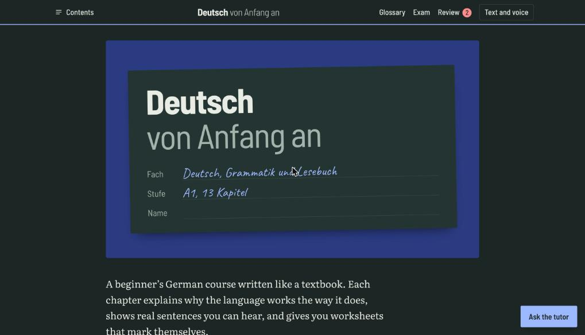
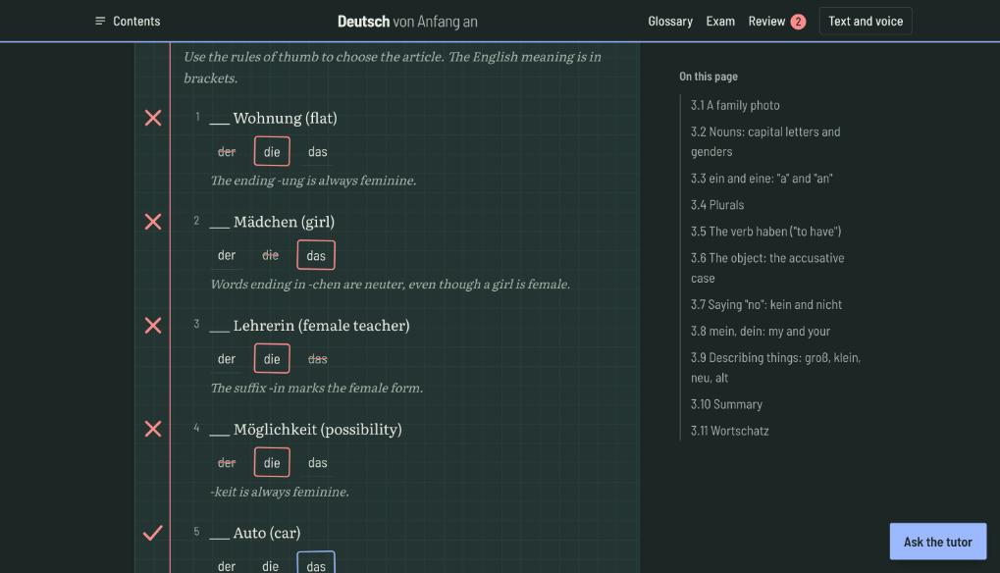
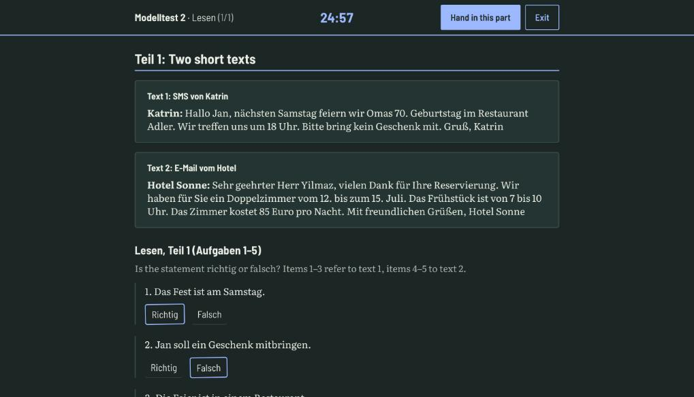
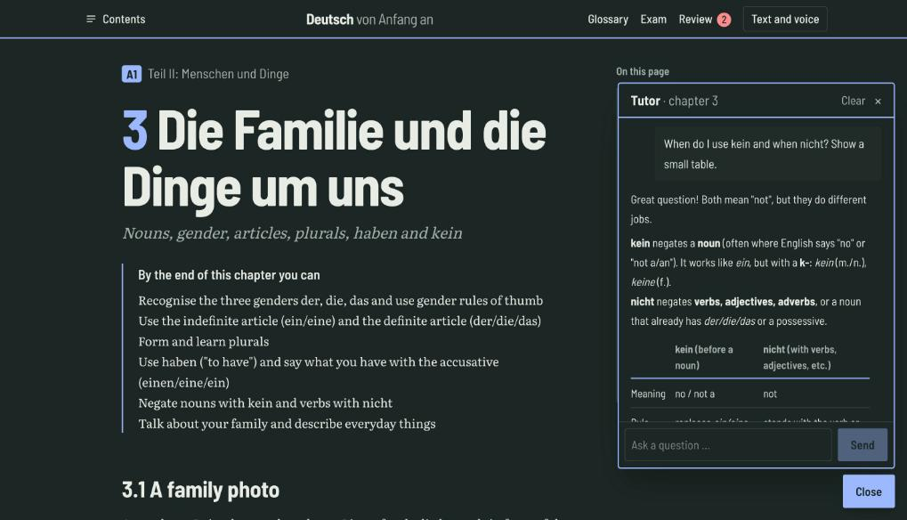

# Deutsch von Anfang an

A German **A1** course written like a textbook, with an app around it: 13 chapters of grammar and reading, worksheets that mark themselves, spaced-repetition vocabulary review, four full **Goethe-Zertifikat A1 (Start Deutsch 1)** mock exams in a timed exam mode, and an AI tutor.

Built with Next.js, Tailwind CSS and SQLite. Everything runs locally; your progress lives in a single database file on your machine.

> Not affiliated with the Goethe-Institut. The mock exams follow the published format and scoring of *Start Deutsch 1* but are original material.

## Screenshots

| | |
|---|---|
| <br>**Cover and contents** | <br>**Worksheets marked in red pencil, with explanations** |
| <br>**Timed Goethe A1 mock exam (Lesen)** | <br>**AI tutor, answering from the current chapter** |

## Features

- **The book.** 13 chapters (about 49,000 words) from the alphabet and greetings to the perfect tense, grouped in seven parts. Every German sentence has a play button (normal and slow); the English translation can be switched off. Callouts mark rules (*Merke*), common mistakes (*Achtung*), tips (*Tipp*), English interference (*Englisch*) and culture (*Landeskunde*).
- **Worksheets.** About 90 exercises of seven types (multiple choice, gap-fill, translation, word order, matching, listening, free writing). They are marked in red pencil and every mistake is explained.
- **Vocabulary review.** About 600 words, always with article and plural. Mark a chapter as read and its words enter a five-box spaced-repetition queue. Modes: flashcards, write it, der/die/das, listening. A searchable glossary lists everything.
- **Exam practice (`/pruefung`).** Four complete Modelltests with Hören (3 Teile), Lesen (3 Teile), Schreiben (2 Teile) and Sprechen (3 Teile). Exam mode runs the real timings (20 / 25 / 20 / 15 minutes), limits the audio (twice in Hören Teil 1 and 3, once in Teil 2), hides answers and hints until the end, and scores like the real exam: raw points per part × 1.66, pass at 60 of 100. Writing and speaking are self-marked against the official criteria. Results are saved.
- **AI tutor.** A chat widget that explains grammar, checks your sentences and answers from the chapter you are reading. Disabled during exams.
- **Voices.** Text to speech through the browser; choose a female or male German voice. Drop `app/public/audio/<word-id>.mp3` files to use real recordings.

## Getting started

Requirements: Node.js 20+ and npm.

```bash
git clone <this repo>
cd <repo>
npm install
npm run setup     # creates data/german.db and loads the book into it
npm run dev       # http://localhost:3000
```

### AI tutor (optional)

The tutor talks to [TokenHarbor](https://tokenharbor.ai) through its OpenAI-compatible API, by default with the free DeepSeek model. Create a `.env` file (see `.env.example`):

```bash
TOKEN_API_KEY=your-key
# optional
# TOKENHARBOR_BASE_URL=https://tokenharbor.ai/v1
# TOKENHARBOR_MODEL=deepseek-v4-flash:free
```

The key is read on the server only and never sent to the browser. Without a key the rest of the app works normally and the tutor says it is not configured.

### Useful commands

| Command | What it does |
|---|---|
| `npm run dev` | Development server |
| `npm run build` / `npm start` | Production build and server |
| `npm run db:seed` | Reload the book into the database after editing a chapter. Your progress is never touched. |
| `npm run lint` | ESLint |

`GERMAN_DB=/path/to/copy.db` points the app at another database file, which is handy for testing.

## Writing content

Chapters are plain Markdown files in `content/book/kNN.md`; mock exams are in `content/tests/testN.md`. Besides normal Markdown they use fenced blocks:

| Block | Purpose |
|---|---|
| `dialogue` | Speaker lines with an English translation after `\|` |
| `examples` | German sentence \| English translation |
| `vocab` | Vocabulary groups: lemma, IPA, translation, example, part of speech |
| `exercise` | A worksheet (`gap`, `choice`, `listen`, `translate`, `order`, `match`, `write`) |
| `merke`, `achtung`, `tipp`, `kultur`, `englisch` | Margin callouts |

Edit a chapter, run `npm run db:seed`, reload. Exam files are read directly from disk, so no seeding is needed. The curriculum plan is in [`docs/curriculum-A1.md`](docs/curriculum-A1.md).

## Project layout

```
content/book/    the 13 chapters (Markdown)
content/tests/   the four Modelltests and the exam-format page
src/app/         routes: /, /kapitel/[id], /glossar, /wiederholung, /pruefung, /api/chat
src/components/  book renderer, exercises, review, exam runner, chat widget
src/lib/         parsers, spaced repetition, exam loader and scoring
src/db/          Drizzle schema and SQLite connection
scripts/seed.ts  loads the book into the database
```

## Tech stack

Next.js 16 (App Router, Turbopack) · React 19 · TypeScript · Tailwind CSS 4 · SQLite via better-sqlite3 and Drizzle ORM · react-markdown with remark-gfm.

## Sources and licences

The grammar structure and many example sentences are adapted from [Wikibooks: German](https://en.wikibooks.org/wiki/German) (CC BY-SA) and [Deutsch im Blick](https://coerll.utexas.edu/dib/) (CC BY 4.0). The scope of A1 follows the Goethe-Institut's published *Prüfungsziele* and word list, used only as a reference; no text was copied. Pronunciations (IPA) are by the author and should be checked against audio.

- **Code:** MIT (see `LICENSE`).
- **Book text** (`content/`): adapted from CC BY-SA material, so it is shared under [CC BY-SA 4.0](https://creativecommons.org/licenses/by-sa/4.0/).
